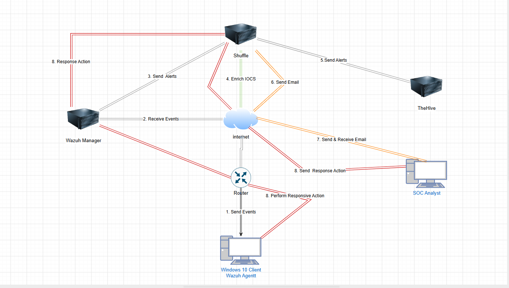
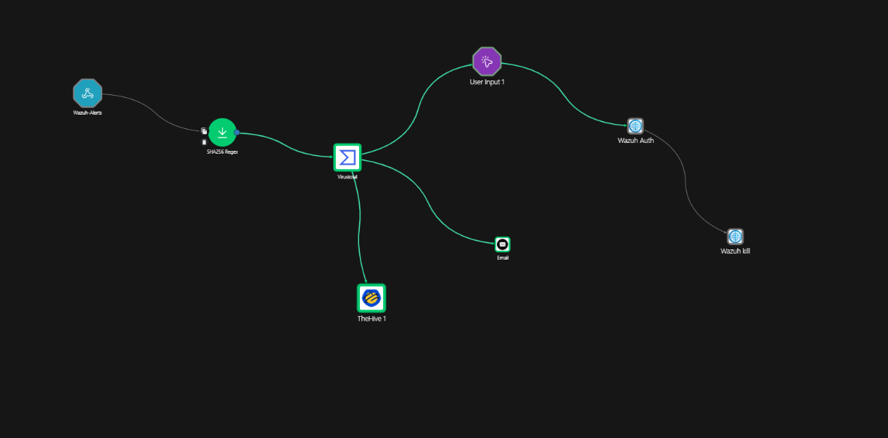

# SOC Automation Lab: Detecting and Responding to Mimikatz

I built a SOC automation pipeline that detects the credential theft tool Mimikatz on a Windows machine, checks the file against threat intelligence, opens a case, emails me for approval, and then stops the malicious process through a Wazuh active response. This repository documents how it works, the problems I hit, and what I learnt.

Everything ran in an isolated lab that I own. Mimikatz was only ever run inside a virtual machine, for detection testing.

**Full write-up:** [Markdown](soc-automation-lab-writeup.md) | [PDF (download)](SOC-Automation-Lab-Writeup.pdf)

## What happens when Mimikatz runs

1. Sysmon on a Windows 10 machine records the new process, including its file hash and original file name.
2. The Wazuh agent sends the event to the Wazuh server in AWS.
3. A custom Wazuh rule (100002, level 15) fires and forwards the alert to Shuffle, the SOAR platform.
4. Shuffle extracts the SHA256 from the alert and checks it on VirusTotal.
5. Shuffle creates an alert in TheHive and emails the details and the VirusTotal verdict.
6. Shuffle emails an approval request. Nothing is killed until I answer.
7. After approval, Shuffle calls the Wazuh API with a restricted service account to run an active response.
8. A script on the Windows machine checks the process is still the one in the alert, kills it by process ID, and logs the result, which flows back into Wazuh.

## Tools used

- Windows 10 virtual machine (VirtualBox) with Sysmon and the Wazuh agent
- Wazuh 4.14.8 (manager, indexer, dashboard) on an AWS EC2 instance, Ubuntu 24.04
- TheHive 5 (with Cassandra and Elasticsearch) on a second EC2 instance
- Shuffle (cloud) as the SOAR platform
- VirusTotal for file hash reputation
- Python 3.14 and PyInstaller for the response script
- MITRE ATT&CK mapping: T1003 and T1003.001 (OS Credential Dumping)

## What I confirmed in testing

- Real Mimikatz produced a level 15 Wazuh alert (rule 100002) and started the Shuffle workflow.
- VirusTotal flagged the file hash as malicious on 64 to 65 of 70 engines, depending on when it was queried.
- TheHive received a High severity alert tagged T1003, and the notification email arrived with the VirusTotal verdict. Emails go to a disposable 10-minute address used only for this lab.
- The approval link opened the right workflow run, and the kill only ran after approval.
- The active response killed the real Mimikatz process. The log recorded its full path, original file name and SHA256, which matched the hash VirusTotal flagged.
- A real run was refused by the script's identity check because Wazuh stores paths with doubled backslashes. I fixed it with a normalising helper (section 7 of the write-up).
- Approvals answered after the process had ended did nothing, because there was no live process to inspect (the stale-PID case).
- The kill result reached the Wazuh archives about one second after it happened.
- The Shuffle service account can run one action on one agent. Asking it for the agent list returned an empty result.

## Skills this lab shows

- Endpoint telemetry with Sysmon and Wazuh
- Detection engineering mapped to MITRE ATT&CK
- Alert enrichment and case management (VirusTotal, TheHive)
- SOAR workflow design with a human approval step
- Writing a safe automated response that verifies before acting
- Least-privilege access for an automation account (Wazuh RBAC)
- Cloud setup on AWS and troubleshooting across connected tools

## Repository contents

- `soc-automation-lab-writeup.md`: the full step by step write-up
- `dSOC-Automation-Lab-Writeup.pdf`: the same write-up as a PDF
- `scripts/kill-mimikatz.py`: the active response script (final version)
- `images/`: the 34 screenshots used in the write-up

## Using the file
- Build the script on Windows with `py -3.14 -m PyInstaller -F kill-mimikatz.py`, place `kill-mimikatz.exe` in the agent's `active-response\bin` folder, and define the command in the manager's `ossec.conf` as shown in section 5.3.

## What this lab does not claim

This is a single-endpoint lab, not a production environment. Killing a process is containment, not full remediation, because credentials may already have been taken by the time an analyst approves. The write-up lists the limits of the lab and what I would do next.
