# SOC Automation Lab: Detecting and Responding to Mimikatz with Wazuh, TheHive and Shuffle

In this lab I built a pipeline that detects Mimikatz on a Windows endpoint, enriches the alert with threat intelligence, opens a case, emails an analyst, waits for approval and then terminates the malicious process through a Wazuh active response. This writeup follows the order I built it in, and explains why each piece is configured the way it is, not only how.

Everything ran in an isolated lab that I own. Mimikatz was only executed inside a virtual machine for detection testing.

## Contents

1. Goal and architecture
2. Setting up the environment
3. Getting Mimikatz into Wazuh: logging and the first rule
4. Implementing SOAR with Shuffle
5. Building the automated response
6. Testing and validation
7. Troubleshooting example: the path check that refused to kill Mimikatz
8. Limits of this lab
9. Future improvements
10. What I learnt
11. Conclusion

## 1. Goal and architecture

I wanted to understand how a SIEM and a SOAR platform hand data to each other, so I built a chain where a real attack tool triggers a detection and that detection flows through enrichment, a case, a notification and a response.

I chose Mimikatz because it is well documented, it maps cleanly to MITRE ATT&CK (T1003, OS Credential Dumping) and it leaves clear evidence on a Windows host.

I drew the architecture before building anything.


*Figure 01. Architecture diagram*

### Components

1. **Windows 10 VM:** the endpoint. Runs Sysmon for telemetry and the Wazuh agent to ship it.
2. **Wazuh server (AWS EC2):** manager, indexer and dashboard. Decodes events, applies rules and raises alerts.
3. **TheHive server (AWS EC2):** case management. Receives enriched alerts.
4. **Shuffle (cloud):** the SOAR platform. Runs the enrichment, notification and approval workflow.
5. **VirusTotal:** file hash reputation.
6. **Analyst mailbox:** receives the notification and the approval request.

### Workflow

1. Sysmon on the Windows VM records the process creation, including file hashes and the original file name.
2. The Wazuh agent forwards the event to the Wazuh manager.
3. A custom rule fires and Wazuh sends the alert to a Shuffle webhook.
4. Shuffle extracts the SHA256 from the alert and queries VirusTotal.
5. Shuffle creates an alert in TheHive and emails the analyst the details and the VirusTotal verdict.
6. Shuffle emails an approval request. Nothing is terminated until the analyst answers.
7. On approval, Shuffle calls the Wazuh API, using a restricted service account, to run an active response.
8. A script on the endpoint verifies the process, kills it by process ID and logs the result, which flows back into Wazuh.

The finished Shuffle workflow is shown in section 5.7.

## 2. Setting up the environment

### 2.1 AWS servers

With the design settled, I hosted the two servers on AWS EC2, both running Ubuntu 24.04. For each one I created a key pair, a security group (a virtual firewall) and an instance.

On the Wazuh server, SSH is allowed only from my own IP address. The dashboard (443) and the agent ports (1514 for event traffic, 1515 for enrollment) are open so the endpoint and I can reach them. TheHive got the same kind of rules for its web interface.

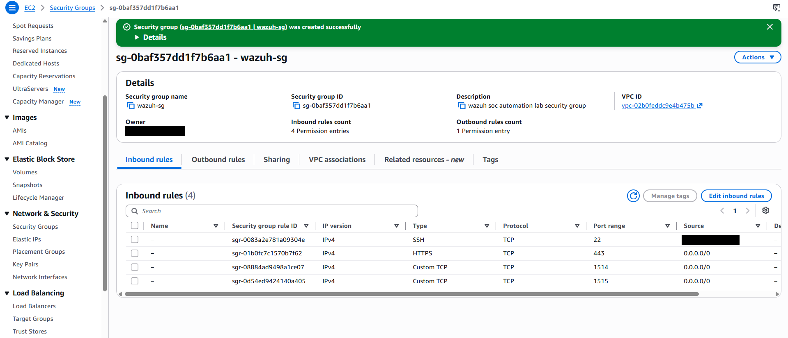
*Figure 02. Security group with its inbound rules (account ID and my IP blacked out)*

### 2.2 Wazuh installation

I used Wazuh's assisted installation script (version 4.14.8), which installs the indexer, the manager, Filebeat and the dashboard in one pass. When it finished, it printed the admin credentials, which I used to log in to the dashboard.

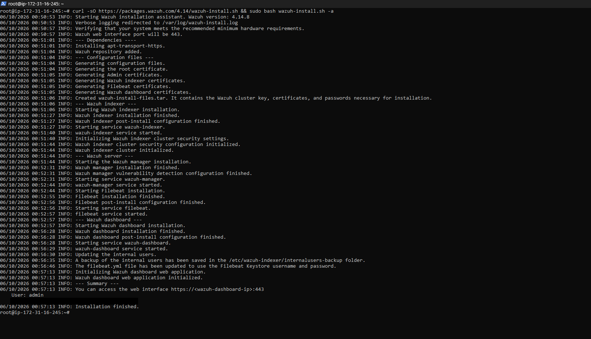
*Figure 03. Wazuh installation script finished (password blacked out)*

### 2.3 TheHive installation

TheHive 5 needs four components: Java, Cassandra (the database), Elasticsearch (the search index) and TheHive itself. The three services have to agree on names and addresses or TheHive will not start, so most of the work here was configuration.

**Cassandra (`cassandra.yaml`).** I set `cluster_name` to `thehive`, set both `listen_address` (node-to-node traffic) and `rpc_address` (client connections) to the server's private address instead of leaving them on localhost, and set the seeds entry to the same address on port 7000, since this is a single node cluster.

Cassandra had already started once with its default cluster name, and it stores that name in its system tables on first start. Changing `cluster_name` afterwards makes it refuse to start, so I stopped the service, cleared `/var/lib/cassandra/`, started it again and confirmed it was listening on port 9042 and healthy with `nodetool status`. Clearing was safe because the database was still empty.

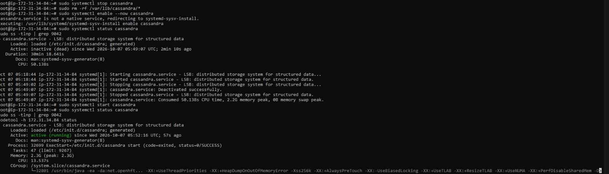
*Figure 04. Stopping Cassandra, clearing its data directory and restarting*

**Elasticsearch (`elasticsearch.yml`).** I set the `cluster.name` and `node.name`, set `network.host` to the private address (it only listens on localhost by default), kept `http.port` at 9200 and set `cluster.initial_master_nodes` to the node's name so a single node cluster can elect itself.

Finally I pointed the storage and index settings in TheHive's `application.conf` at the same hosts and cluster names. TheHive's login page loading was the first confirmation that the cloud side worked.

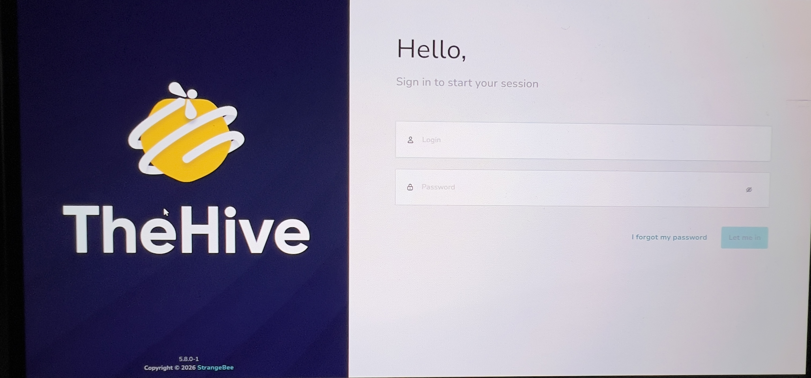
*Figure 05. TheHive login page*

### 2.4 Windows endpoint: Sysmon and the Wazuh agent

On the Windows 10 VM I installed Sysmon first. Default Windows logging does not record process command lines, parent processes or file hashes, and the detections in this lab depend on them.

Then I installed the Wazuh agent and enrolled it with the manager. The agent does not read the Sysmon channel on its own, so I added a `localfile` entry to its `ossec.conf`:

```xml
<localfile>
  <location>Microsoft-Windows-Sysmon/Operational</location>
  <log_format>eventchannel</log_format>
</localfile>
```

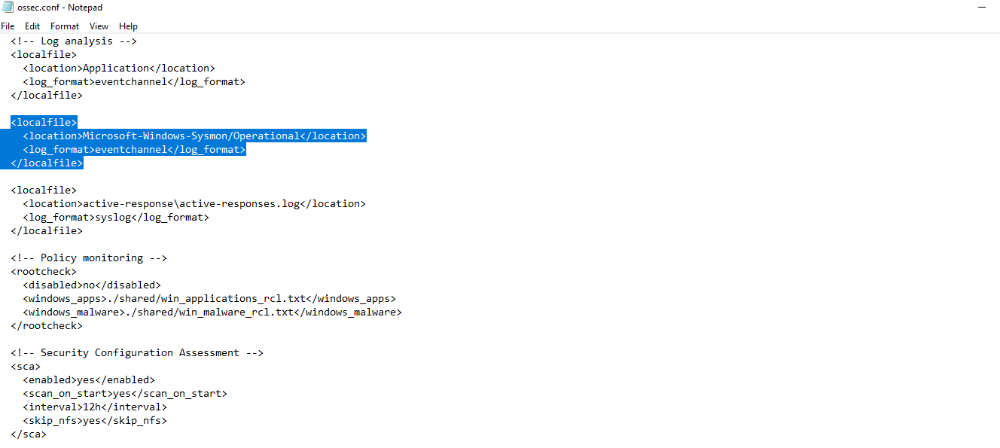
*Figure 06. Sysmon channel added to the agent configuration*

After restarting the agent, Sysmon events started to appear in the dashboard, and the agent showed as active.

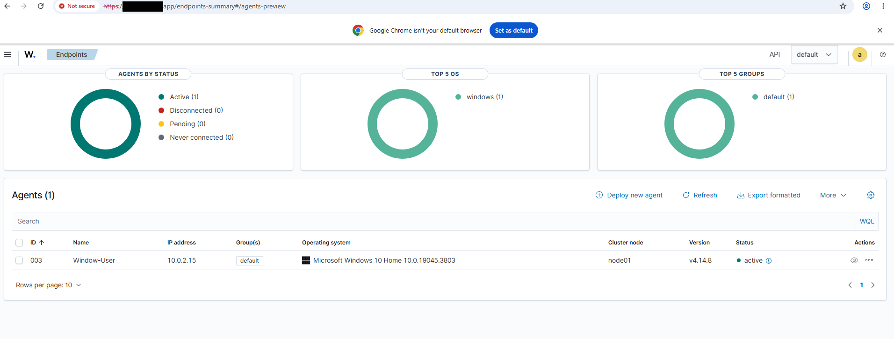
*Figure 07. Agent 003 enrolled and active (dashboard address blacked out)*

## 3. Getting Mimikatz into Wazuh: logging and the first rule

### 3.1 Why Wazuh did not show Mimikatz at first

For the test malware, I downloaded Mimikatz onto the Windows VM. Mimikatz is an open source tool that extracts credentials such as plaintext passwords, NTLM hashes and Kerberos tickets from Windows memory, mostly from the LSASS process. Attackers use it for credential dumping and lateral movement, which is why it is such a common detection target (MITRE ATT&CK T1003).

I ran it on the endpoint and searched the dashboard, and nothing appeared. Wazuh only stores events that match a rule at or above `log_alert_level` (3 in my configuration). The built-in Sysmon rule for process creation is level 0, so Mimikatz starting was analyzed and then discarded.

To see the raw events I changed `logall` to `yes` in the manager's `ossec.conf` (with `logall_json` so the archive is stored as JSON). This is off by default because it stores everything, including sensitive command lines, and costs disk and indexing capacity. In a lab it shows me the exact field names to write rules against.

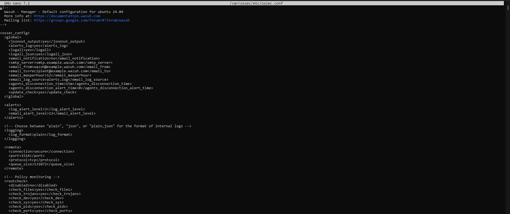
*Figure 08. logall and logall_json enabled in the manager configuration*

Archived events are written to `archives.json` on the manager, but they only reach the indexer if Filebeat ships them. So I also enabled the archives module in `/etc/filebeat/filebeat.yml` (`archives: enabled: true`), restarted the manager and Filebeat, and created a `wazuh-archives-*` index pattern in the dashboard.

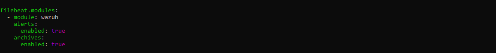
*Figure 09. Filebeat archives module enabled*

Mimikatz then appeared with all its Sysmon fields.

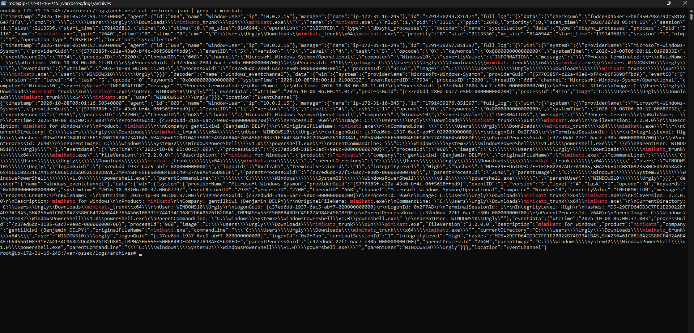
*Figure 10. Mimikatz events on the Wazuh server, with the Sysmon fields I needed*

### 3.2 Rule 100002: detecting Mimikatz by original file name

With the real field names visible, I wrote my first rule. Custom rule IDs in Wazuh must be between 100000 and 120000.

```xml
<rule id="100002" level="15">
  <if_group>sysmon_event1</if_group>
  <field name="win.eventdata.originalFileName" type="pcre2">(?i)mimikatz\.exe</field>
  <description>Mimikatz Usage Detected</description>
  <mitre>
    <id>T1003</id>
  </mitre>
</rule>
```

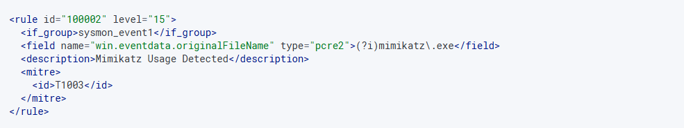
*Figure 11. Rule 100002 as added to local_rules.xml*

The rule matches Sysmon Event 1 and checks `originalFileName`, not `image`. The original file name is stored in the executable's version resource, so a simple rename on disk changes `image` but not `originalFileName`. That makes the rule harder to dodge than one keyed on the file name, but it is not evasion-proof. An attacker can still edit the resource, recompile the tool or use different tooling altogether. A stronger setup would pair it with behavior-based detections (see Future improvements).

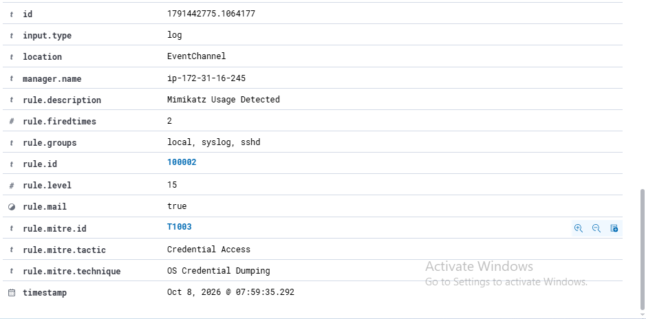
*Figure 12. Rule 100002 in Discover: level 15 alert*

## 4. Implementing SOAR with Shuffle

### 4.1 Connecting Wazuh to Shuffle

Shuffle generates a webhook URL for each workflow. I added an `integration` block to the manager's `ossec.conf` naming the built-in `shuffle` integration, giving it that webhook URL, and restricting it to rule 100002 so only this detection starts the workflow:

```xml
<integration>
  <name>shuffle</name>
  <hook_url>https://shuffler.io/api/v1/hooks/[webhook URL from Shuffle]</hook_url>
  <rule_id>100002</rule_id>
  <alert_format>json</alert_format>
</integration>
```

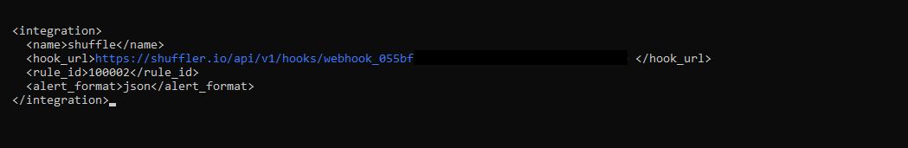
*Figure 13. Integration block in the manager configuration (webhook ID partly obscured)*

### 4.2 Enrichment, case creation and notification

I built the workflow in stages, starting with the webhook and working outwards. The finished workflow is shown in section 5.7.

The webhook receives the full Wazuh alert as JSON.

**SHA256 extraction.** Sysmon's `hashes` field holds several hashes in one string (MD5, SHA256 and IMPHASH). A regex capture step pulls out only the SHA256 with `(?<=SHA256=)[A-Fa-f0-9]{64}`, using a lookbehind so the `SHA256=` prefix is not part of the match.

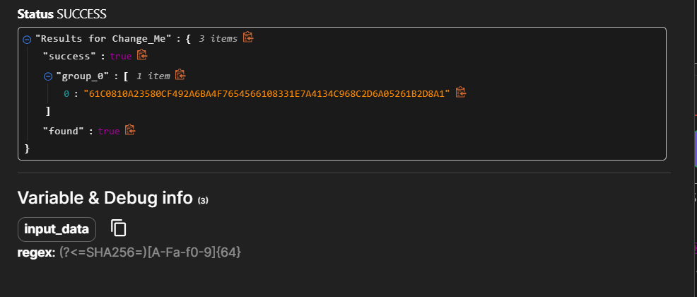
*Figure 14. Regex result: the extracted SHA256*

**VirusTotal.** The hash goes to the VirusTotal "get a hash report" action.

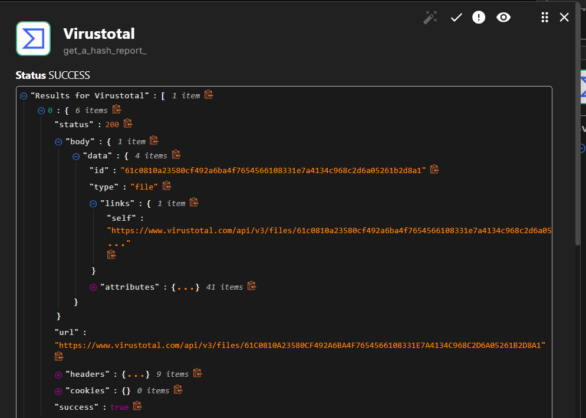
*Figure 15. VirusTotal report returned inside Shuffle*

I then searched the same hash on the VirusTotal website to confirm the result.

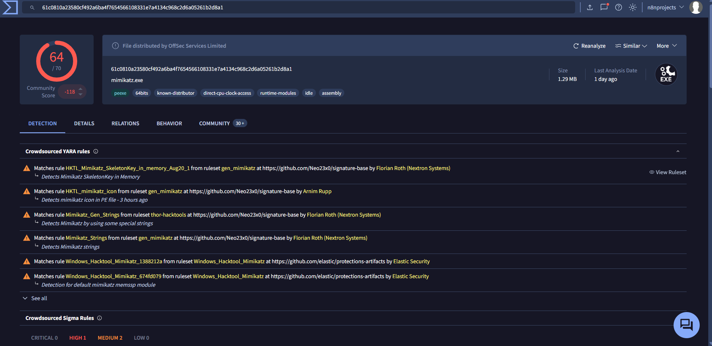
*Figure 16. The same hash on the VirusTotal website: 64 of 70 engines flag it*

**TheHive.** An alert is created with High severity and the tag T1003. For this I created a separate organisation and a service account in TheHive, generated an API key for it and used that key in Shuffle, so Shuffle does not hold an administrator credential.

**Email.** The email node sends the time, host and alert title, plus the VirusTotal verdict. I used a disposable 10-minute email address as the recipient, since this is a lab. This is the same disposable address that receives the approval request in section 5.6.

### 4.3 First end-to-end test, before any response

Before adding any response action, I ran Mimikatz on the endpoint to confirm the pipeline worked from detection to notification. The alert appeared in TheHive, and the notification email, with the VirusTotal verdict in the body, landed in my mailbox.

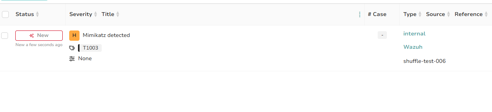
*Figure 17. Alert created in TheHive: High severity, tag T1003*

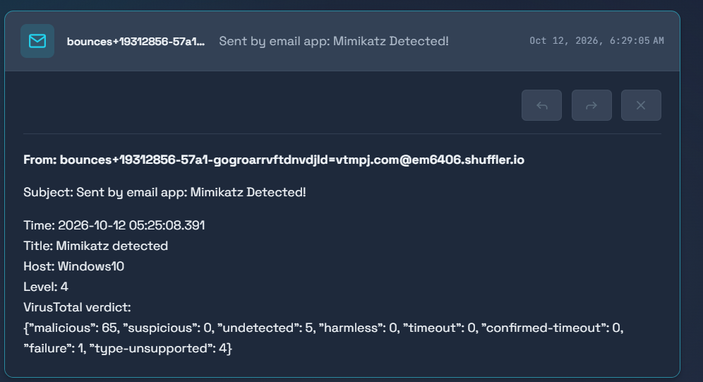
*Figure 18. Email with the VirusTotal verdict (sent to the disposable address)*

The counts differ by one between my captures: the analyst email shows 65 malicious and 5 undetected, the website shows 64 and 6. Both add up to the same 70 engines, so one engine changed its verdict between scans. The `last_analysis_stats` field is a snapshot of the most recent analysis, and vendors change verdicts as they update signatures. Shuffle itself returned both values at different times.

The "Level: 4" in the email is the Windows event severity (`win.system.level`, Information), not the Wazuh rule level. The rule level for this alert is 15, as the Discover entry in section 3.2 shows.

## 5. Building the automated response

Up to this point the pipeline only reports. This phase adds a response, and it is where most of the design decisions are.

### 5.1 Why kill by process ID

My first idea was to kill any process named `mimikatz.exe`. That misses renamed copies and can match the wrong process. The alert already carries the exact process ID, so the better approach is to terminate that one process. Windows reuses process IDs, though, so by the time the response runs the PID could belong to a different program. The script therefore has to verify that the process currently running under that PID is the one the alert described.

### 5.2 The response script

I wrote `kill-mimikatz.py` and compiled it to `kill-mimikatz.exe` with PyInstaller (`-F`, single file), so the endpoint does not need Python installed. Wazuh's Windows active response runs the executable and passes the alert as JSON on standard input.

I installed Python 3.14 through the Python install manager, and PyInstaller with `py -3.14 -m pip install pyinstaller`.

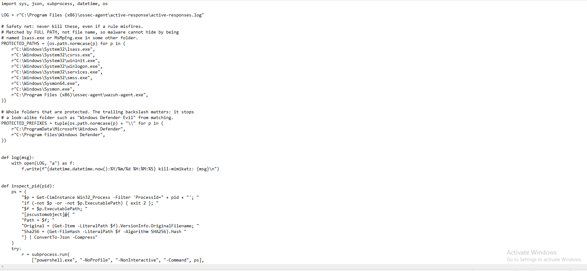
*Figure 19. First version of the script: protected list and process inspection*

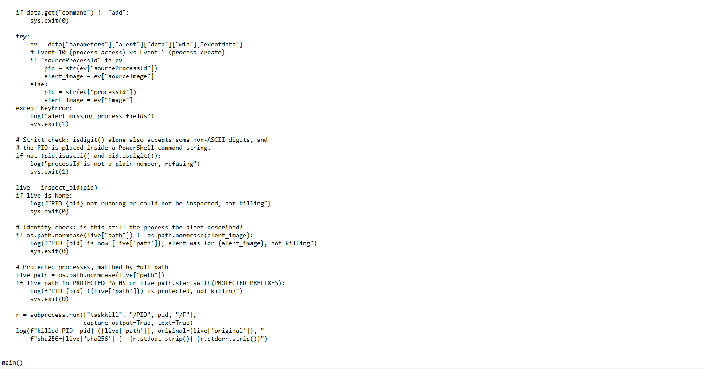
*Figure 20. First version of the script: main logic*

These screenshots show the first version. The final script, with the path fix described in section 7, is in the repository.

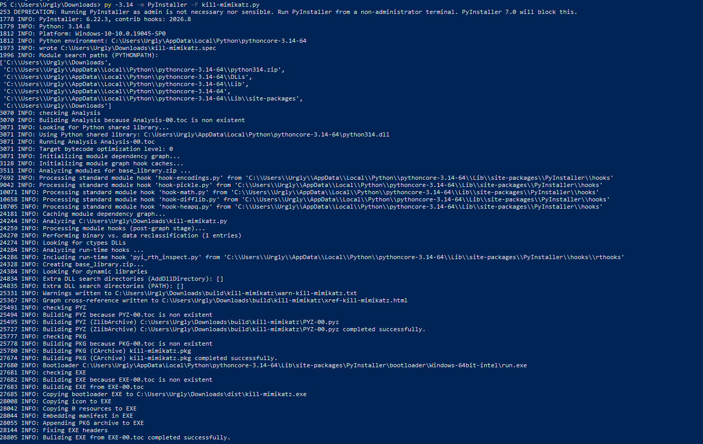
*Figure 21. Building the executable*

What the script does, in order:

1. Reads the JSON from stdin and exits unless `command` is `add`.
2. Takes the PID and image path from the alert (`processId` and `image`, the Sysmon Event 1 fields).
3. Requires the PID to be ASCII digits only (`pid.isascii() and pid.isdigit()`). The PID is placed inside a PowerShell command, and `isdigit()` alone accepts some non-ASCII digits.
4. Asks Windows for the live process with that PID (`Get-CimInstance Win32_Process`) and reads its executable path, `VersionInfo.OriginalFilename` and SHA256 (`Get-FileHash`).
5. **Identity check:** compares the live path with the path in the alert and exits without killing if they differ.
6. **Protected list:** refuses to kill `lsass.exe`, `csrss.exe`, `wininit.exe`, `winlogon.exe`, `services.exe`, `smss.exe`, Sysmon, the Wazuh agent and the Defender folders. These are matched by full path, not file name, so a look-alike in another folder is not protected by the list. The folder prefixes end in a backslash so `Windows Defender Evil` does not match.
7. Runs `taskkill /PID <pid> /F` and writes one log line with the path, original file name, SHA256 and result.

### 5.3 Registering the command in Wazuh

The compiled `kill-mimikatz.exe` sits in the agent's `active-response\bin` folder, which is where Wazuh looks for response executables. On the manager I defined the matching command:

```xml
<command>
  <name>kill-mimikatz</name>
  <executable>kill-mimikatz.exe</executable>
  <timeout_allowed>no</timeout_allowed>
</command>
```

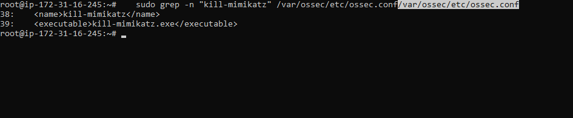
*Figure 22. Confirming the command is present in ossec.conf*

I deliberately did not add an `<active-response>` block that runs it automatically on a rule match. A defined command can only be run when something calls the Wazuh API, which keeps a human decision in front of it.

### 5.4 A least-privilege API user for Shuffle

Shuffle is a third party cloud service. To call the Wazuh API it must store a credential, and port 55000 must be reachable from the internet. With the admin account, anyone who obtained that credential, through a leaked workflow export or a compromised Shuffle account, could run commands on every agent and control the Wazuh server.

I applied least privilege using Wazuh RBAC. The policy (`ar-kill-mimikatz`) allows one action on one resource: `active-response:command` on `agent:id:003`, the Windows VM. I attached it to a role (`ar-operator`) and assigned that role to a dedicated user (`shuffle-ar`) with "Allow run as" off, so it cannot act as another user.

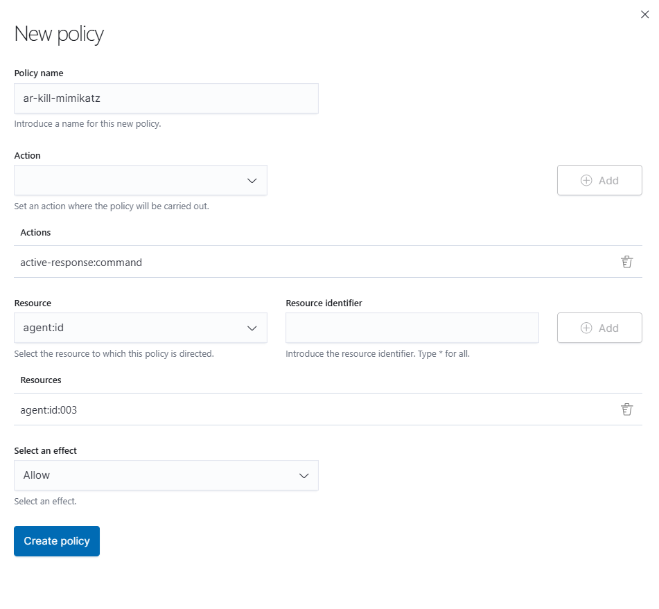
*Figure 23. Policy: one action, one agent*

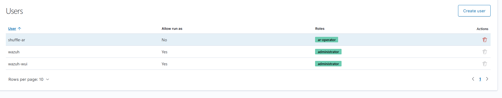
*Figure 24. Users list: shuffle-ar holds only the ar-operator role*

To prove the limit, I authenticated as that account and asked for the list of agents. Wazuh returned an empty result even though the agent exists. If this credential leaks, the worst outcome is my kill script running on one lab machine.

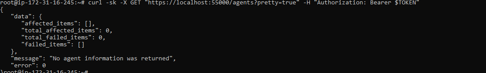
*Figure 25. Limited account sees no agents*

I also restricted the port. I opened 55000 briefly so Shuffle could connect, read Shuffle's source address from the Wazuh API log, and then limited the security group rule to that single address (`/32`).

### 5.5 Calling the response from Shuffle

Two HTTP steps run after approval. The first, Wazuh Auth, authenticates (`POST /security/user/authenticate?raw=true`) with the `shuffle-ar` credentials and receives a JWT. The second, Wazuh kill, calls `PUT /active-response?agents_list=003` with the header `Authorization: Bearer $wazuh_auth.body` and a body that passes the alert's event data to the script:

```json
{"command":"!kill-mimikatz.exe","alert":{"data":$exec.text}}
```

The `!` prefix tells Wazuh to run the executable named in the command directly. The Wazuh API uses a self-signed certificate in my lab, so certificate verification (`Verify`) is set to false in both steps. In production I would install a trusted certificate and turn it back on.

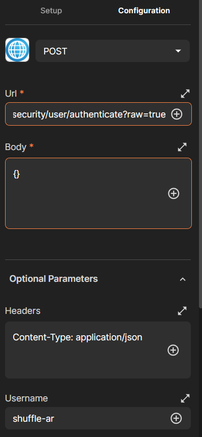
*Figure 26. HTTP step 1: Wazuh Auth*

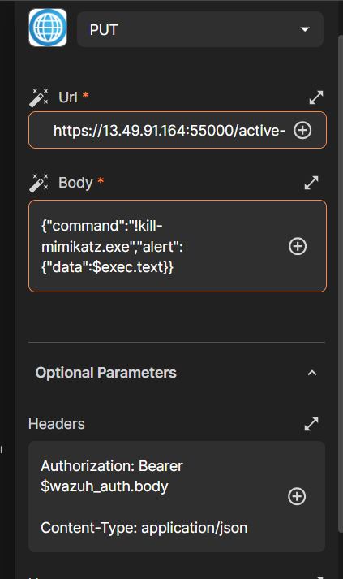
*Figure 27. HTTP step 2: Wazuh kill*

### 5.6 Human approval

The notification email and TheHive alert go out immediately, but the kill path sits behind a Shuffle User Input step that emails the analyst an approve/deny link and pauses the workflow. Killing a process is disruptive and destroys memory an investigator might want, and a misfiring rule could hit something important. So the automation gathers context quickly and leaves the action with consequences to a person.

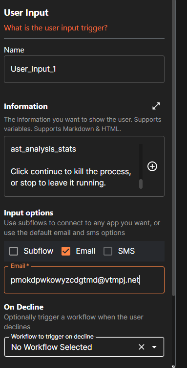
*Figure 28. User Input step configured to send an email*

The email below went to my disposable 10-minute address, which I use for all Shuffle emails in this lab, so I left the approve and deny links visible. It was sent at 23:49 UTC on 16 October for PID 3880, an earlier run than the kills in section 6.

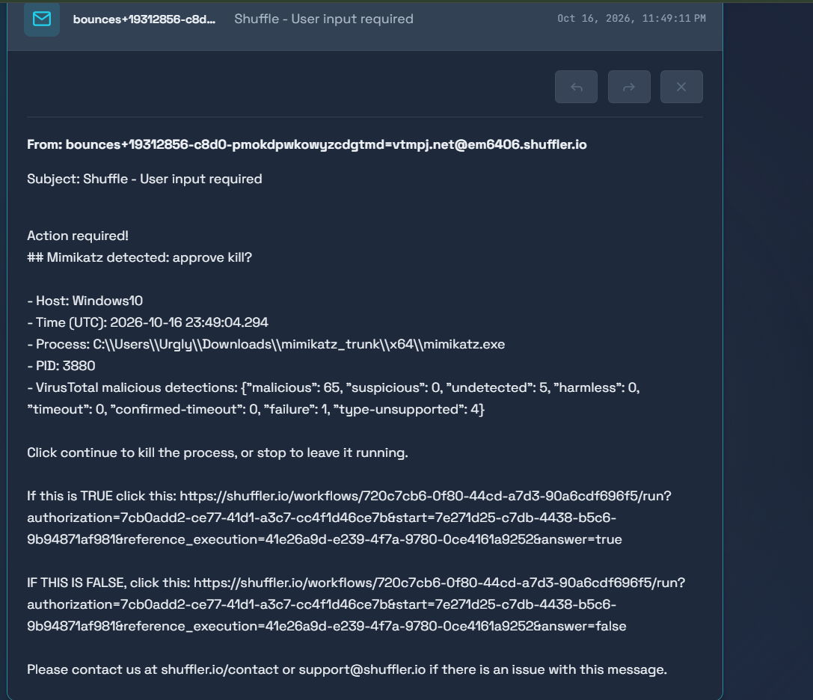
*Figure 29. Approval email sent to the disposable address, with the approve and deny links*

Opening the approve link from that email loads Shuffle's confirmation page for that execution, with the details of the alert and the Continue and Stop buttons. This shows the link works as intended: it lands on the right workflow run, and nothing happens until I choose.

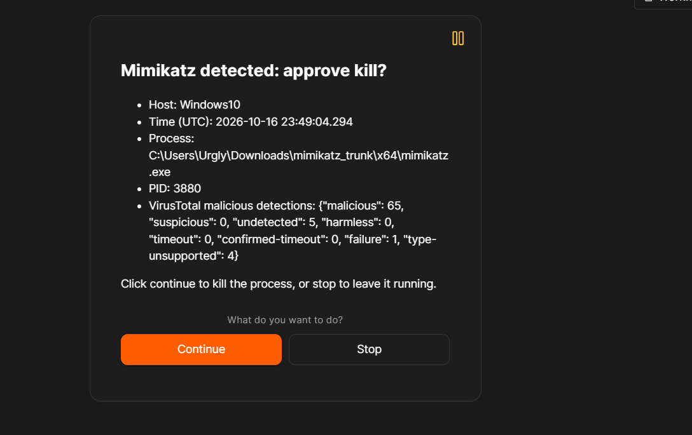
*Figure 30. Page opened from the approval link: alert details with Continue and Stop*

### 5.7 The complete workflow

The webhook feeds the regex step, then VirusTotal. From VirusTotal the workflow fans out three ways: TheHive and the notification email run immediately, and User Input 1 waits for the analyst. Only after approval do Wazuh Auth and Wazuh kill run.


*Figure 31. Final Shuffle workflow*

## 6. Testing and validation

I ran the full chain with real Mimikatz several times between about 00:49 and 01:40 on 17 October. Each run is a separate Mimikatz execution with its own process ID, so the screenshots in this writeup carry different PIDs. The endpoint log in section 7 records what the script decided each time:

- **01:15:02, PID 5488:** the approval was answered while Mimikatz was running, but the script refused to kill it, because the path in the alert did not match the live path (the cause and fix are in section 7).
- **01:15:13, 01:27:30 and 01:33:14, PID 3880:** approvals for the earlier run whose email is in section 5.6 (23:49 UTC). They were answered after that process was no longer running, so the script had nothing to inspect and did nothing. That is the stale-PID case the identity check exists for.
- **01:32:49, PID 2852:** after the path fix, the process was killed.
- **01:38:58, PID 6428:** killed again. This is the run recorded in the Wazuh archives below.

The approval email in section 5.6 and the kill logs therefore show different PIDs because they come from different executions, not one continuous test.

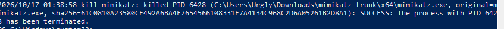
*Figure 32. Kill at 01:38: PID 6428 terminated*

The log line from the run records the full path, `original=mimikatz.exe` and the SHA256 `61C0810A23580CF492A6BA4F7654566108331E7A4134C968C2D6A05261B2D8A1`, which is the hash VirusTotal flagged.

Because full logging was already on, the script's log file is also collected by the Wazuh agent. Searching the archives shows the response recorded in the SIEM about one second after it happened, which gives an analyst an audit trail without logging in to the endpoint.

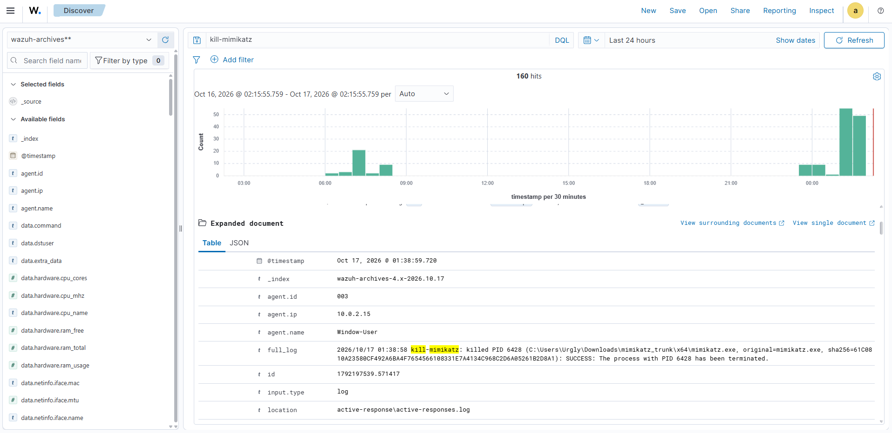
*Figure 33. Kill recorded in the Wazuh archives*

## 7. Troubleshooting: the path check that refused to kill Mimikatz

In the real Mimikatz run at 01:15 (PID 5488), the workflow completed, the API call returned success, and Mimikatz kept running. The script's log showed why. The first line below is the refusal, and the later lines are the other approvals described in section 6.

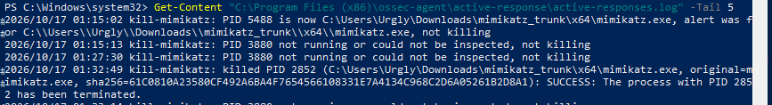
*Figure 34. Endpoint log: the script refusing to kill (01:15:02) and the later approvals*

The script had stopped at this check:

```python
if os.path.normcase(live["path"]) != os.path.normcase(alert_image):
    log(f"PID {pid} is now {live['path']}, alert was for {alert_image}, not killing")
    sys.exit(0)
```

The log line printed both paths. The live path from Windows was `C:\Users\...\mimikatz.exe` with single backslashes. The path in the alert was `C:\\Users\\...\\mimikatz.exe`, with doubled backslashes (the approval email in section 5.6 shows the same form). Wazuh's Windows event decoder stores backslashes doubled in the alert fields, so the two strings never matched, and the script treated the real Mimikatz process as an impostor.

The fix was a small helper that collapses repeated backslashes before any comparison, used for the identity check and the protected path list:

```python
def norm(p):
    return os.path.normcase(re.sub(r"\\+", r"\\", p))

if norm(live["path"]) != norm(alert_image):
    ...
```

I rebuilt the executable with PyInstaller so the new version was the one in the agent's `active-response\bin` folder, and repeated the test, which produced the successful kills in section 6.

Two things I took from this. First, the safety check failed closed: a mismatch meant no kill, not a wrong kill. Second, the script logs both values it compared, which turned a silent failure into a one-line diagnosis, so every refusal should say why it refused.

## 8. Limits of this lab

- **It is one endpoint in a lab.** A real SOC has many hosts, more noise and more rules.
- **One detection rule.** The workflow is triggered by a single rule keyed on the original file name, so it covers Mimikatz specifically and would not catch other credential dumping tools.
- **Killing a process is containment, not remediation.** By the time an analyst approves, credentials may already have been dumped. A real response would also reset affected credentials, review what the account touched and possibly isolate the host.
- **The approval gate was not tested on its own.** The kill path is wired behind the approval step and the kill was tested end to end, but I did not do a dedicated run proving nothing happens before the click.
- **Some choices are lab shortcuts.** Certificate verification is off for the Wazuh API, VirusTotal is on a rate-limited free tier, TheHive is on a trial licence, and notifications and approvals go to a disposable 10-minute email address.

## 9. Future improvements

- **Behavior-based detections.** Add rules for suspicious access to LSASS memory (Sysmon Event 10) and for Mimikatz command-line strings, so detection does not depend on a single indicator. The response script already reads the Event 10 field names. The LSASS rule would need a baseline and an allowlist of known good programs by full path, because Defender and Task Manager legitimately open LSASS.
- **Deduplicate alerts** so one execution creates one case.
- **Host isolation.** Offer an isolate-host option alongside the process kill.
- **Close the loop in TheHive.** Write the response outcome back to the case.
- **Harden the setup.** Install trusted certificates, put the Wazuh and TheHive interfaces behind a VPN or source restrictions, and use a real mailbox.

## 10. What I learnt

- **Wazuh only shows what a rule promotes.** Mimikatz ran on the VM and the dashboard stayed empty until I turned on `logall` and read the raw events. Since then I look at the real field names first and write the rule second.
- **Automation that kills things has to doubt its own input.** I spent more effort on the checks around `taskkill` than on the kill itself, because a reused PID or a spoofed path would make it hit the wrong process.
- **A successful response code is not a result.** The kill node returned 200 while pointed at the wrong URL, so I now confirm the effect on the endpoint and in the log.
- **Debugging is mostly reading what the tool already printed.** My guess about the backslashes was wrong, and the one log line showing both paths settled it in seconds.
- **Least privilege is easy to claim and more convincing to prove.** Getting an empty agent list back from `shuffle-ar` showed me exactly what a leaked credential could and could not do.

## 11. Conclusion

The lab shows a full detect, enrich, case, notify, approve and respond loop built from open source and free tier tools, with each hand-off tested. It is small, but every part of it was built, broken and fixed by me, and the pieces I am least certain of are written down in the limits section rather than hidden.
